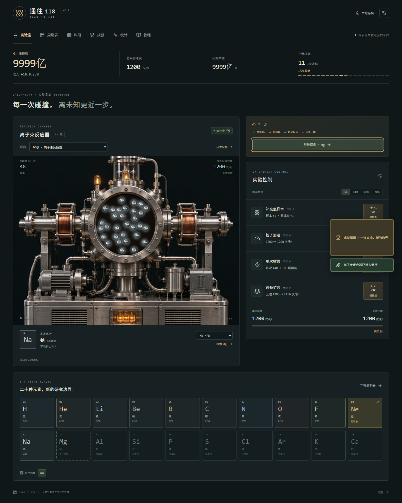

# 通往118 · Road to 118

从两颗氢原子开始，建立属于你的元素实验室。当前版本 **v0.2：前 20 号元素**。

## 一键开始

### [▶ 点击这里，直接开始游戏](https://xd666-afk.github.io/road-to-118/)

手机和电脑浏览器均可，无需安装或注册。[完整教程](https://xd666-afk.github.io/road-to-118/#guide)在游戏的独立栏目中。



## 第一次怎么玩

1. 观察实验，积累碰撞能，用来补样、加速、提高单次收益。
2. 依次探索 H→Ca。发现 Be / N / Ne / Ar，分别开放 II / III / IV / V 级仪器。
3. 研发自动补样、批量生产和自动提交，让旧仪器继续生产，新仪器继续探索。
4. 从库存累计提交 50 单位即可点亮一格。发现下一种不要求先完成收录。
5. **50 Ne 是第一阶段里程碑；50 Ca 完成 v0.2 阶段。** 完成后仍可继续收集全部前二十格。

## 从旧版继续

- 原 v0.1 的十元素存档会自动扩展，余额、设备、库存、部分提交、成就和氖里程碑保留。
- 已发现 Ne 的玩家可以在「下一步」建造 IV 级；发现 Ar 后开放 V 级。
- 存档每 12 秒保存在当前浏览器；右上角设置可导出、导入。换网址或设备时，先在原处导出，再到新处导入。
- 离线最多结算 4 小时的收入和已知元素，首次发现在线触发。

## 当前内容

- H—Ca 二十种元素与完整 118 格周期表；21—118 保留为未来目标。
- I—V 五代写实仪器，用简洁选择器切换，旧仪器保留运行。
- 二十张元素档案：质子、电子、指定同位素中子、电子排布/分层、常温状态、性质用途、相变与自然分布。
- 原十号里程碑及六项新成就，共 16 个普通、4 个隐藏成就。
- 自动化、50 单位分批收录、大数显示、本地存档、离线收益和手机布局。

## 验证与节奏

45 项自动化测试、17 条浏览器流程通过。三种策略各 1,000 次种子模拟，均无 60 分钟超时。

新手策略每 8 秒执行一次操作：3 分钟内 II 级建成 100%，首次收录 99.7%；收录 50 Ca 的中位约 14.83 分钟，p90 约 16.83 分钟。结果来自模拟，不代表真实玩家留存或任意操作方式的时间保证。[原始模拟数据](artifacts/simulation.json)。

## 本地启动

需要 Node.js 24 或兼容版本：

```bash
git clone https://github.com/xd666-afk/road-to-118.git
cd road-to-118
npm ci
npm run dev
```

Windows 也可下载后双击 `启动通往118.cmd`，打开终端显示的网址。

```bash
npm test
npm run build
npm run preview
npm run test:browser
npm run simulate
npm run simulate -- --runs=20
```

浏览器检查使用本机 Microsoft Edge；静态成品输出到 `dist/`，可交由竞赛平台托管。

## 科学与美术说明

碰撞能、合成概率和依序发现是游戏机制，不是真实核反应路线。仪器为概念美术，粒子大小和颜色为示意。元素数据保留 RSC 等核对来源；公开阅读入口使用对应的百度百科词条。

磷样本采用红磷，相变数据注明白磷条件；氩样本为常温无色气体。图集由 AI 生成，完整提示词、布局和观察窗几何见[素材说明](public/assets/provenance.json)。

暂未提供：21—118 号实际研究、VI—X 级仪器、PWA 离线启动缓存、声音、账号与多人模式。真实手机与 Safari 仍需继续试玩验证。

## 更新与反馈

`main` 更新后自动测试、构建并发布到 GitHub Pages。[部署记录](https://github.com/xd666-afk/road-to-118/actions) · [反馈问题](https://github.com/xd666-afk/road-to-118/issues)。
